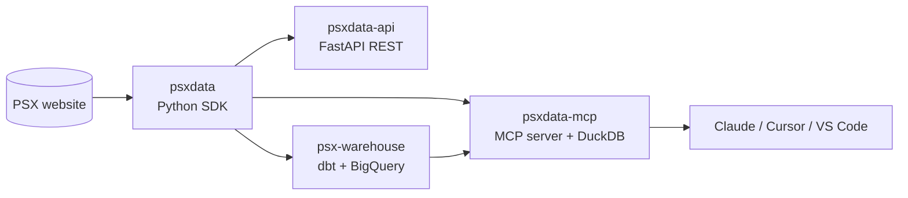

## Hi, I'm Muhammad Tauha

**Data & AI Engineer**: I build data pipelines, APIs and LLM tooling, and ship them as open-source products people actually use.

My main project is **[psxdata](https://github.com/psxdata)**, an open-source data platform for the Pakistan Stock Exchange. It runs end to end: a Python SDK that scrapes and cleans market data, a public REST API, a dbt warehouse on BigQuery, and an MCP server that lets AI assistants analyse the market with SQL.

---

### What I work on

- **Data engineering:** extraction from messy sources, append-only raw layers, dbt modelling (staging → marts, SCD Type-2 snapshots), warehouses on BigQuery and DuckDB/MotherDuck.
- **AI engineering:** MCP servers, LLM agents with tool use, and reusable analysis skills that turn a model into a domain assistant.
- **Backend & APIs:** FastAPI services with caching, rate limiting, typed errors and CI/CD to production.
- **Infrastructure:** Docker, Terraform, GCP (Cloud Run, Cloud Scheduler) and GitHub Actions with Workload Identity Federation.

---

### psxdata: open-source PSX data platform

#### [psxdata](https://github.com/psxdata/psxdata): Python library

Historical OHLCV, live quotes, index constituents, sectors, fundamentals, debt market and margin-eligible stocks for 1,000+ PSX tickers, returned as pandas DataFrames.

- Parses columns dynamically from the HTML, so it survives PSX layout changes that break other scrapers
- Disk cache, retries with exponential backoff, rate limiting and proxy support (HTTP / SOCKS5)
- About 9,000 PyPI downloads a month

#### [psxdata-api](https://github.com/psxdata/psxdata-api): REST API

A public FastAPI service on top of the SDK. **[Live API](https://psxdata-api.fastapicloud.dev)**

- Consistent response envelope with typed error codes and `Retry-After` handling
- Per-IP rate limiting and response caching
- Docker image on Docker Hub, CI/CD and auto-deploy, logs exported hourly to MotherDuck

#### [psx-warehouse](https://github.com/psxdata/psx-warehouse): analytics warehouse

Turns raw PSX data into tested, analysis-ready marts. **[dbt docs & lineage](https://psxdata.github.io/psx-warehouse/)**

- Append-only, hash-diffed raw layer, so a restated price is never silently overwritten
- dbt staging → marts: a Type-2 ticker snapshot (handles delistings), dimensions and five fact tables (OHLCV, index membership, sector daily, valuation daily, restatement history)
- BigQuery in production, DuckDB/MotherDuck for local dev
- Terraform-managed GCP: Cloud Run Job, Cloud Scheduler, least-privilege service account, keyless deploys via Workload Identity Federation

#### [psxdata-mcp](https://github.com/psxdata/psxdata-mcp): MCP server for AI assistants

Gives Claude, Cursor and VS Code access to PSX data. The assistant loads data into a private in-memory DuckDB and answers questions with SQL.

- 11 tools (prices, screener, indices, sectors, fundamentals, sandboxed SQL) with row and time limits
- 6 analysis skills: stock tearsheets, value/dividend/momentum screens, Shariah screens, multi-stock comparisons, daily market wraps
- One-click installs: Claude Code plugin, Claude Desktop bundle (`.mcpb`), Cursor and VS Code
- A hosted, invite-only version with OAuth sign-in that also exposes the warehouse marts

Docs for the whole platform: **[psxdata.mintlify.app](https://psxdata.mintlify.app)**

---

### Tech stack

| Area | Tools |
| --- | --- |
| **Languages** | Python, SQL, Go, TypeScript |
| **Data** | dbt, BigQuery, DuckDB, MotherDuck, PostgreSQL, pandas |
| **AI** | Model Context Protocol (MCP), LLM agents & tool use, Claude |
| **Backend** | FastAPI, REST API design, web scraping |
| **Cloud & DevOps** | GCP (Cloud Run, Cloud Scheduler), AWS, Terraform, Docker, GitHub Actions |
